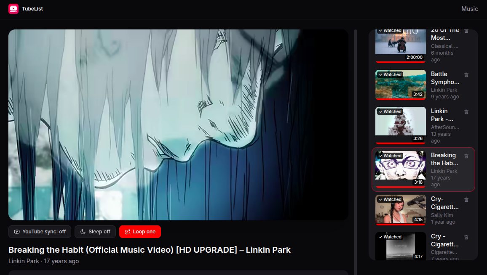
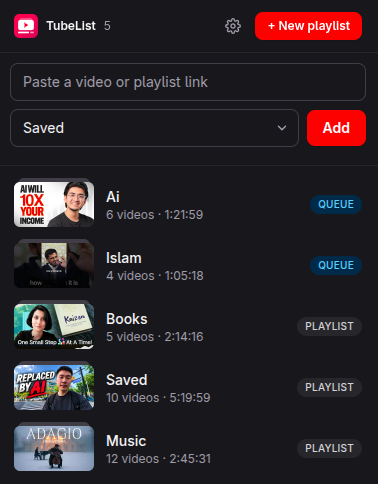
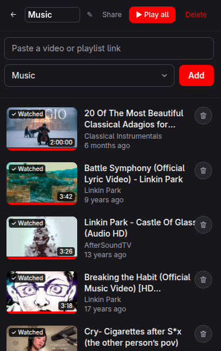
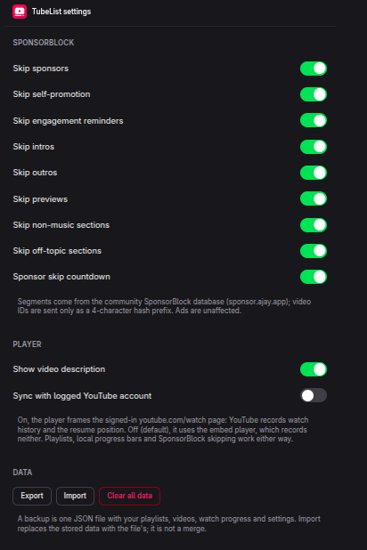

# 🎬 TubeList

A lightweight browser extension (Manifest V3, Chromium **and** Firefox) that turns YouTube videos, playlists and queues into your own local playlists — and plays them through the **real YouTube watch page**, so every play lands in your **YouTube watch history** and resume position, exactly like watching on youtube.com.

## Screenshots

<table>
  <tr>
    <td colspan="2" align="center">
      <strong>Player</strong><br>
      
    </td>
  </tr>
  <tr>
    <td align="center" width="50%">
      <strong>Playlists</strong><br>
      
    </td>
    <td align="center" width="50%">
      <strong>Playlist contents</strong><br>
      
    </td>
  </tr>
  <tr>
    <td colspan="2" align="center">
      <strong>Settings</strong><br>
      
    </td>
  </tr>
</table>

## 📊 Stats

| Metric | Value |
| --- | --- |
| Version | `0.5.0` (Manifest V3) |
| Targets | Chromium (`dist/`), Firefox 140+ (`dist-firefox/`) |
| Source files | 18 TypeScript (+1 stylesheet) |
| Source lines | ~2,460 |
| Tests | 145 across 17 vitest suites |
| Runtime dependencies | **0** |
| License | MIT |
| Dev dependencies | 7 (`vite`, `typescript`, `vitest`, `jsdom`, `tailwindcss` ×2, `@types/chrome`) |
| Bundle size | ~90 KB unpacked (`dist/`) |
| Tracked files | 63 |
| Commits | 35 |

## ✨ Features

- 🖱️ **Save anything** — right-click any YouTube video, playlist or `watch_videos` queue link → *Add to TubeList*. Pick an existing playlist or create a new one. A link that carries a personal list (`&list=WL`, `&list=LL`) adds **the video**: Watch Later and Liked are account lists this extension deliberately cannot read, and neither can it read a playlist the account keeps private — metadata requests are sent without cookies.
- 🔗 **Or paste a link** — the popup has a link field: a video link goes to the playlist picked in the menu under it (it follows the playlist you open, default *Saved*); a playlist or queue link is saved as its own playlist.
- 🔄 **Optional account sync** — *Settings* → Player or the **YouTube sync** button on the player page turns on *Sync with logged YouTube account*, which frames the actual signed-in `youtube.com/watch` page, so YouTube itself records watch history and the resume position. Off by default, the embed player records neither.
- 🔁 **Loop modes** — the **Loop** button cycles off → all → one: *all* advances through the playlist and wraps at the end, *one* replays the current video. The choice is remembered.
- 😴 **Sleep timer** — the **Sleep** menu on the player page pauses playback after 5, 10, 15, 30, 45 or 60 minutes, or cancels it, and counts the remaining time down on the button. It lasts for the session: a reload starts with the timer off, so playback never stops on its own.
- 📈 **Progress bars & resume** — watched percentages on every thumbnail, auto-resume where you left off.
- 🧹 **Lite player chrome** — the watch page is trimmed to just the video player; no masthead, sidebar or comments. The embed player has its own minimal chrome.
- 📝 **Description toggle** — the video's description sits in a collapsible panel under the player; *Settings* → Player hides it. Rows saved before v0.4 fetch their description once, on first view.
- ▶️ **Player source toggle** — *Settings* → Player → *Sync with logged YouTube account* is off by default: playback uses YouTube's embed player. Turn it on for the real `youtube.com/watch` page (watch history and account resume). Playlists, local progress bars and SponsorBlock skipping work in both.
- ↔️ **Resizable playlist sidebar** — drag the divider between the player and the playlist on desktop (or focus it and use ←/→); the width is remembered.
- ↕️ **Reorder videos** — drag a row, or focus it and press Alt+↑/↓, in the popup or the player; the new order is saved with the playlist.
- 📤 **Share a playlist** — the popup copies a YouTube `watch_videos` queue link for the playlist (first 50 videos); anyone can open it as a temporary YouTube playlist, and another TubeList user can right-click it → *Add to TubeList*.
- ⏭️ **SponsorBlock skipping** — crowd-sourced sponsor, self-promotion, engagement, intro, outro, preview and non-music segments are skipped inside the frame. *Off-topic filler* is offered but **off by default**, and highlights are not offered at all: the database stores them as a single moment, with no span to cut. Every category has its own toggle (plus a 3-second sponsor countdown) in *Settings* → SponsorBlock.
- 💾 **Local-first playlists** — playlists live in `chrome.storage.local`. No account, no server, nothing leaves your machine.
- 🧳 **Export, import, clear** — *Settings* → Data writes every playlist, video, watch position and setting to one JSON file, reads such a file back (replacing what is stored — it is not a merge) or clears all of it after a confirm. The file is produced by the browser itself: nothing is uploaded, and a clear cannot be undone.

## ⚙️ How it works

- The player page frames `https://www.youtube.com/embed/<id>?autoplay=1&start=<s>` inside an iframe by default, or `https://www.youtube.com/watch?v=<id>` when *Settings* → Player turns on *Sync with logged YouTube account* (the watch page keeps watch history and the account resume position). The content script matches `/embed/*` too, so progress, the sponsor skip and the ad handling behave the same in both modes. An embed request carries `Referer: https://tubelist.app/` from a `declarativeNetRequest` rule: an extension page sends no referrer of its own, and YouTube answers a referrer-less embed with *Error 153*. A `declarativeNetRequest` rule strips `x-frame-options`/`content-security-policy` for `www.youtube.com` frames started by the extension **or by YouTube itself** — the player page reloads its own frame once (`&themeRefresh=1&theme=dark`) to sync the theme, and that reload is refused otherwise. The real player then loads with its cookies and history reporting intact. The rules are installed at runtime (`updateDynamicRules`) against the extension's own host from `runtime.getURL()`, which is `chrome-extension://<id>` in Chrome and `moz-extension://<uuid>` in Firefox — `runtime.id` is the gecko id there and matches no initiator.
- A small content script (`src/frame.ts`) hides YouTube's page chrome inside the frame and reports `timeupdate`/`pause`/`ended` back to the player page for progress tracking. The channel runs both ways, and the only command so far is the sleep timer's `pause`: the `<video>` lives in the frame, and the player page is a cross-origin embedder. The skip decision itself is a pure function (`src/lib/skip.ts`), so the countdown and seek-into rules are unit-tested without a video element.
- Playlist edits are applied by the service worker and nowhere else: `src/lib/store.ts` describes each edit as one operation, the popup and the player send it over `runtime.sendMessage`, and the worker answers with the result. A context-menu save and a popup edit therefore cannot overwrite each other, and the same operations prune progress rows for videos no playlist holds any more.
- SponsorBlock segments come from the community API at `sponsor.ajay.app`, queried with the first 4 characters of the SHA-256 hash of the video ID. The lookup runs in the service worker (`src/background.ts`), not in the content script: the framed watch page's CSP covers content-script `fetch` calls ("Unsafe attempt to load URL ... Domains, protocols and ports must match"), so a request from `frame.ts` is blocked on pages that still carry a policy — the service deliberately has no video-ID lookup, so that prefix is all that leaves the browser. `src/frame.ts` skips an enabled segment inside its existing 500 ms loop, remembers segments you seeked into (they stay unskipped for that video), and shows a 3-second countdown before skipping a sponsor. Categories are read from the stored prefs object, so the settings page and the frame share one source of truth. Ads are not covered by SponsorBlock data and keep the fast-forward path: each ad is jumped to half a second before its end and played out, so YouTube's own end-of-break handling runs — seeking to the exact end can leave the break stuck on screen at `0:15 / 0:15`. *Skip highlights* is deliberately not offered: the database stores highlights as a single moment (start == end), so there is no span to cut.
- Metadata, playlist contents and queue expansion come from YouTube's InnerTube API (`src/lib/innertube.ts`) using the `WEB` client, with the `Origin` header rewritten for extension pages.

## 📋 Requirements

- A Chromium-based browser (Chrome, Helium, Edge, Brave, ...), or Firefox 140+ (see [Firefox](#-firefox)).
- Signed in to YouTube in that browser if you want plays to reach your YouTube watch history. Without a sign-in, playback and local progress still work.

## 📦 Install (from source)

```sh
pnpm install
pnpm build          # emits dist/
```

Then load the unpacked extension:

1. Open `chrome://extensions`
2. Enable **Developer mode**
3. **Load unpacked** → select the `dist/` directory

## 🦊 Firefox

```sh
pnpm build:firefox  # emits dist-firefox/
```

Firefox has no MV3 service worker, so `dist-firefox/manifest.json` runs the same code as an **event page** (`background.scripts` + `type: "module"`), and declares the options page through `options_ui`. Both builds get the same `declarativeNetRequest` rules and the same `src/` — the only source difference is the frame's "am I embedded by TubeList?" check: `location.ancestorOrigins` answers it on Chromium, and a handshake with the player page answers it on Firefox, which sends no extension referrer for the frame.

Then load the unpacked extension:

1. Open `about:debugging#/runtime/this-firefox`
2. **Load Temporary Add-on…** → select `dist-firefox/manifest.json`

### Permanent install

A temporary add-on is dropped every time the browser closes. Package the build once and install it for real:

```sh
pnpm build:firefox
pnpm dlx web-ext build --source-dir dist-firefox --artifacts-dir . --overwrite-dest   # → tubelist-<version>.zip
```

1. Rename that artifact to `tubelist.xpi`.
2. Zen, Developer Edition, Nightly and ESR accept an unsigned build once `xpinstall.signatures.required` is `false` in `about:config`. Then `about:addons` → gear → **Install Add-on From File…** → pick the `.xpi`. It loads at every start from then on.
3. Stock Firefox ignores that preference, so its builds have to be signed. Get AMO API keys from <https://addons.mozilla.org/developers/addon/api/key/> and run:

```sh
pnpm dlx web-ext sign --source-dir dist-firefox --channel=unlisted --api-key=<key> --api-secret=<secret>
```

`--channel=unlisted` returns a private, signed `.xpi` (no public listing) in `web-ext-artifacts/`. Install that file the same way — it needs no preference changes and works on stock Firefox.

Prefer `WEB_EXT_API_KEY` / `WEB_EXT_API_SECRET` environment variables over the flags: they are account credentials, and a command line ends up in shell history and process lists. Rotate the key pair if it ever reaches a log or a transcript.

Instead of the `about:addons` step, an unsigned build also survives restarts when its `.xpi` sits in the profile's `extensions/` directory — again only on builds that honour the signature preference, with `extensions.autoDisableScopes` set to `0` (Firefox disables add-ons it did not install itself).

Firefox 140+ also shows the extension's data-collection declaration in the install prompt and in `about:addons`: **browsing activity**, required, for the SponsorBlock hash prefix described in [PRIVACY.md](PRIVACY.md). Nothing else leaves the browser.

Firefox blocks audible autoplay by default, so a video may start paused inside the player — press play once. Everything else (history, resume, SponsorBlock, progress bars) behaves as in Chrome.

## 🛠️ Development

```sh
pnpm build          # typecheck + production build into dist/
pnpm build:firefox  # typecheck + production build into dist-firefox/
pnpm dev            # rebuild on change (development mode)
pnpm dev:firefox    # rebuild dist-firefox/ on change
pnpm test           # vitest suite
```
Release history lives in [CHANGELOG.md](CHANGELOG.md); every release is tagged `v<version>`.

After a build, press ⟳ on the extension in `chrome://extensions`: the service worker stays registered against the files it was loaded from, and a stale registration shows up as *"An unknown error occurred when fetching the script"*.

### Reproducing the submitted package

The `.zip` uploaded to addons.mozilla.org is `dist-firefox/` and nothing else, built from the tagged source with no code generated at packaging time:

```sh
pnpm install --frozen-lockfile   # pnpm 11.13.1, Node 20 or newer (see package.json)
pnpm test                        # 145 tests, 17 suites
pnpm build:firefox               # typecheck + vite build --mode firefox
pnpm dlx web-ext lint --source-dir dist-firefox   # 0 errors, 0 warnings
pnpm dlx web-ext build --source-dir dist-firefox --artifacts-dir . --overwrite-dest
```

`dist-firefox/` holds the readable output of that build: `manifest.json` (from `manifests/firefox.json`), the four page bundles plus `background.js` (an ES module), one classic-script content script (`frame.js`, no imports), the shared `chunks/`, `assets/` and `icons/`. Everything an extension needs is in `src/`; there is no remote code, no eval, and no runtime dependency.

## 🔐 Permissions

| Permission | Why |
| --- | --- |
| `contextMenus` | "Add to TubeList" on YouTube links |
| `storage` | Playlists and playback progress |
| `declarativeNetRequestWithHostAccess` | Origin rewrite for InnerTube; header strip for the framed watch page |
| `scripting` + `activeTab` | Name prompt when creating a playlist from the context menu |
| host `https://www.youtube.com/*` | InnerTube metadata and the framed watch page |

## 🕵️ Privacy

TubeList talks to **YouTube** (youtube.com, i.ytimg.com thumbnails) and, for SponsorBlock skipping, to **sponsor.ajay.app** — sending only the 4-character hash prefix of the video ID, never the ID itself, your account or your history. No analytics, no other third-party servers, no account of its own. Your playlists and progress stay in the browser's local storage. Playback behavior is indistinguishable from watching the video on youtube.com. The full details are in [PRIVACY.md](PRIVACY.md).
