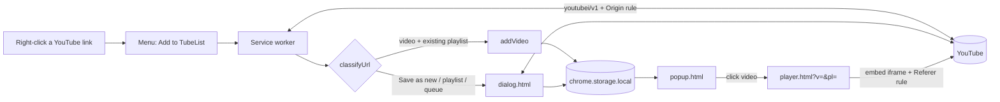
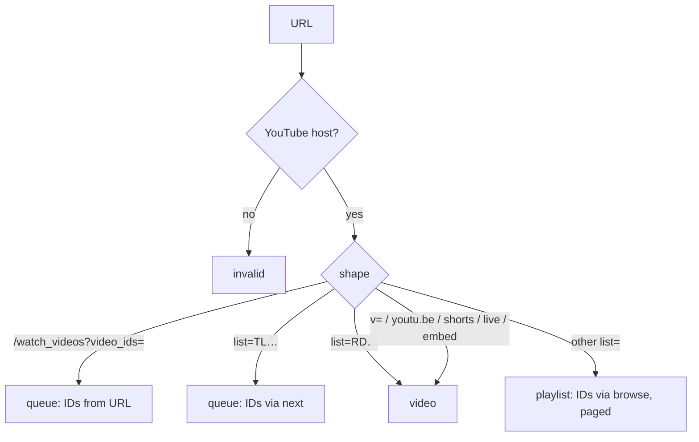

# TubeList — Build Plan

You are building a Chrome extension (Manifest V3) named **TubeList**. Follow this file top to bottom. Every decision is already made. Do not add features, libraries, or files that are not listed here.

## 0. Rules for the build agent (read first)

- Build in the **milestone order** below. After each milestone, run its check. Do not start the next milestone until the check passes.
- If something in this file does not work, use §9 Contingencies first. If §9 does not cover it, pick the smallest fix and log it under `Deviations` in `context/BUILD_REPORT.md`. Never silently change a spec value: names, strings, IDs, and classes are copied exactly.
- Do not add features, dependencies, or files beyond §4. Do not delete or rewrite tests to make them pass. Fix the code.
- Never use `innerHTML`, `eval`, or remote `<script src>`.
- Commit with git after each milestone: `git init` at M1, then `git commit -am "M<n>: <title>"`.

### Milestones

| # | Title | Scope (sections) | Check that must pass |
|---|---|---|---|
| M1 | Scaffold | §3, §4, §5 (configs, manifest, icons), §7.9 `dom.ts` + `styles.css`, empty `popup.html`/`dialog.html`/`player.html` with placeholder `<h1>` | `pnpm build` exits 0; `dist/manifest.json` and `dist/icons/icon-16.png` exist |
| M2 | Pure libs | §6 types, §7.1 url, §7.4 format, §8.2 setup, `url.test.ts`, `format.test.ts` | `pnpm test` green |
| M3 | Storage | §7.3 store, `store.test.ts` | `pnpm test` green |
| M4 | YouTube data | §7.2 innertube, §8.1 fixtures script (run it), `innertube.test.ts` | `pnpm test` green; `tests/fixtures/*.json` committed |
| M5 | Background | §7.5 (both DNR rules, menus, flash) | `pnpm build` 0; load `dist/` unpacked; no errors on the service worker in `chrome://extensions`; right-click a YouTube link shows **Add to TubeList → Save as new playlist…** |
| M6 | Dialog | §7.6 | §8.4 steps 3, 5, 6, 7 |
| M7 | Popup | §7.7 | §8.4 steps 4, 9 |
| M8 | Player | §7.8 | §8.4 step 8 |
| M9 | Final pass | everything | `pnpm build && pnpm test` green; all of §8.4 steps 1–11 pass; `BUILD_REPORT.md` written |

If you can't do a manual browser step (for example, running headless), write `MANUAL-PENDING` for that step in the report and continue. Never mark it as passed.

### Handoff: `context/BUILD_REPORT.md` (required, written at M9)

The reviewer reads this file first, so use exactly this template:
```md
# TubeList build report
Model: <model name>   Date: <YYYY-MM-DD>   Commit: <git rev-parse --short HEAD>

## Milestones
| # | Status (PASS/FAIL/PARTIAL) | Notes |
|---|---|---|
| M1 | | |
... M2–M9

## Test output
<paste the last 15 lines of `pnpm test`>

## Manual checks (§8.4)
| Step | PASS / FAIL / MANUAL-PENDING | What I saw |
|---|---|---|
| 1 | | |
... 2–11

## Deviations from plan.md
- <section> — <what changed> — <why>   (write "None" if empty)

## Contingencies used (§9)
- <which one> — <result>   (or "None")

## Known issues / open questions
- ...
```

## 0.1 Overview diagrams





## 1. What the user wants

- Right-click any YouTube link, or right-click anywhere on a YouTube page. The menu shows the TubeList icon and an **Add to TubeList** submenu.
- The submenu has **Save as new playlist…**, then a separator, then one item per existing TubeList playlist.
- The extension supports several local playlists.
- It saves only the **video ID**, plus metadata fetched for that ID: title, thumbnail, duration, channel name, and publish date.
- There are three link types:
  1. **Single video**: save that one video.
  2. **YouTube playlist** (`list=PL…`, `UU…`, `OL…`, etc.): create a separate TubeList playlist that contains every video in it, using the YouTube playlist title by default.
  3. **Queue** (`/watch_videos?video_ids=a,b,c`, or any URL whose `list` starts with `TL`): get every video ID in the queue and save them as a new playlist of kind "queue". The user types the name.
- All data lives in the browser's local extension storage (`chrome.storage.local`). There is no server, no API key, and no login.
- The popup (toolbar icon) lists playlists. Inside a playlist, each video shows its thumbnail, title, duration, channel, and publish date.
- Clicking a video opens the extension's **own player page** (`player.html`, bundled inside the extension, not an external site) in a new tab. The page plays the video in an embedded YouTube player and sets the tab/page title (`document.title`) to the video title. The playlist's other videos are listed next to the player, and clicking one switches the video and the title without reloading the page.
- The extension has a polished, modern icon and an easy-to-use UI styled with **Tailwind CSS**.

## 2. Research findings (verified 2026-11-13 with live requests)

| Topic | Finding | Source |
|---|---|---|
| Context menu | `chrome.contextMenus`, permission `contextMenus`. In MV3 service workers, use `onClicked` and do not pass the `onclick` property. Chrome puts the extension icon next to the item. `targetUrlPatterns` filters the `href` of `link` contexts. `documentUrlPatterns` filters by the page URL. | https://developer.chrome.com/docs/extensions/reference/api/contextMenus |
| Storage | `chrome.storage.local` holds 10 MB, survives clearing history, and works in service workers. `window.localStorage` is not recommended for extensions and is not available in service workers. | https://developer.chrome.com/docs/extensions/reference/api/storage |
| Official YouTube Data API v3 | `playlistItems.list` and `videos.list` require an API key and quota. The user does not want any key, so this API is **not used**. It also cannot read `TL…` queue lists. | https://developers.google.com/youtube/v3/docs/playlistItems/list |
| oEmbed | `https://www.youtube.com/oembed?url=…&format=json` needs no key but returns only title, author, and thumbnail (no duration or date). Not used. | live test |
| InnerTube (YouTube's internal web API, keyless) | `POST https://www.youtube.com/youtubei/v1/{player,next,browse}?prettyPrint=false` with JSON body `{"context":{"client":{"clientName":"WEB","clientVersion":"2.20261112.00.00","hl":"en","gl":"US"}}, ...}` returns everything needed. The API is unofficial and can change, so all parsing lives in one file (`src/lib/innertube.ts`) with fixture tests. | live test |
| `player` `{videoId}` | `videoDetails.{videoId,title,author,lengthSeconds}` and `microformat.playerMicroformatRenderer.publishDate` (ISO). For an invalid ID, `playabilityStatus.status` is `"ERROR"` and `videoDetails` is missing. `status:"UNPLAYABLE"` still includes `videoDetails`, so treat it as valid. | live test |
| `browse` `{browseId:"VL"+listId}` | Title is at `metadata.playlistMetadataRenderer.title`. Videos are `lockupViewModel` objects with `contentType:"LOCKUP_CONTENT_TYPE_VIDEO"`, and the video ID is in `contentId`. Each page has 100 of them. The next-page token is at `continuationItemViewModel…continuationCommand.token`; send it back as `browse` with `{continuation: token}`, same item shape. Verified: 442 videos over 5 pages. Unknown or private list gives HTTP 400. Older responses used `playlistVideoRenderer.videoId`, so collect both. | live test |
| `next` `{playlistId:"TL…"}` | `contents.twoColumnWatchNextResults.playlist.playlist.{title,totalVideos,contents[].playlistPanelVideoRenderer.videoId}`. Queue title is `"Untitled List"`. Returns at most about 80–200 items, which is fine for queues. | live test |
| `watch_videos?video_ids=a,b,c` | YouTube redirects this to `watch?v=a&list=TLGG…`. The IDs are already in the URL, so parse them directly with no request. | live test |
| **Origin block** | InnerTube returns **403** when `Origin: chrome-extension://…` and 200 when `Origin: https://www.youtube.com`. Fetch cannot set `Origin`, so a `declarativeNetRequest` `modifyHeaders` rule rewrites it. | live test + https://developer.chrome.com/docs/extensions/reference/api/declarativeNetRequest |
| Thumbnails | `https://i.ytimg.com/vi/{id}/mqdefault.jpg` (320×180) always exists. Build it from the ID instead of storing YouTube's signed URLs. | live test |
| Player page in extension | A plain `<iframe src="https://www.youtube.com/embed/{id}">` inside a `chrome-extension://` page fails with **Error 153** (`embedder.identity.missing.referrer`) because Chrome sends no `Referer` from extension pages, and YouTube requires one. Fix (confirmed working in the Chromium Extensions group thread): a DNR `modifyHeaders` rule that **sets** `referer` on `sub_frame` requests to `www.youtube.com` from this extension (DNR cannot *append* `referer`, but it can *set* it). YouTube's documented Referer format for apps is an HTTPS URL whose host is `<app-name>.<AppID>`. | https://groups.google.com/a/chromium.org/g/chromium-extensions/c/OUJad0q-d_g , https://github.com/w3c/webextensions/issues/896 , https://developers.google.com/youtube/terms/required-minimum-functionality#referer-format |
| Remote scripts | MV3 extension pages cannot load remote JS, so `https://www.youtube.com/iframe_api` **cannot** be used. Use a plain `<iframe>`. The page title comes from metadata already stored locally, so no player API is needed. | https://developer.chrome.com/docs/extensions/develop/migrate/improve-security |
| Embed params | `autoplay=1`, `rel=0` (related videos from the same channel only), `playsinline=1`. The player must be at least 200×200; 16:9 at 480×270 or larger is recommended. | https://developers.google.com/youtube/iframe_api_reference , https://developers.google.com/youtube/player_parameters |

## 3. Stack

- TypeScript, Vite (multi-page build, no CRX plugin), Vitest, `@types/chrome`. Package manager: `pnpm`.
- Styling: **Tailwind CSS v4** through `@tailwindcss/vite`. There is one CSS entry, `src/styles.css`, containing only `@import "tailwindcss";`, and every HTML page imports it. Write no other custom CSS except the few lines in §7.9. Dark mode uses Tailwind's default `dark:` variant (`prefers-color-scheme`).
- The UI uses plain DOM with no framework. Set text through `textContent` only and **never use `innerHTML` with data**, because titles and channel names are untrusted. Build elements with a tiny local helper `h(tag, className, ...children)` in `src/lib/dom.ts` (see §7.9).
- No other runtime or dev dependencies.

## 4. Project structure

```
tubelist/
  context/plan.md                 (this file)
  package.json
  tsconfig.json
  vite.config.ts
  popup.html
  dialog.html
  player.html
  public/
    manifest.json
    icons/icon.svg, icon-16.png, icon-32.png, icon-48.png, icon-128.png
  src/
    background.ts                 service worker: menus, DNR rules (origin + referer), single-video add
    lib/types.ts                  Video, Playlist, PlaylistKind, LinkInfo
    lib/url.ts                    classifyUrl(), playerUrl(), embedUrl(), thumbUrl(), constants
    lib/innertube.ts              fetch wrappers + pure parsers + mapPool()
    lib/store.ts                  chrome.storage.local CRUD
    lib/format.ts                 formatDuration(), formatPublished()
    lib/dom.ts                    h() element helper
    styles.css                    @import "tailwindcss";
    popup/popup.ts
    dialog/dialog.ts
    player/player.ts
  tests/
    setup.ts                      in-memory fake of chrome.storage.local
    url.test.ts
    innertube.test.ts
    store.test.ts
    format.test.ts
    fixtures/*.json               captured by scripts/capture-fixtures.sh
    manual/links.html             manual right-click test page
  scripts/capture-fixtures.sh
```

## 5. Config files

`package.json`, which pins nothing else:
```json
{
  "name": "tubelist",
  "private": true,
  "version": "0.1.0",
  "type": "module",
  "scripts": {
    "dev": "vite build --watch --mode development",
    "build": "tsc --noEmit && vite build",
    "test": "vitest run"
  }
}
```
Then run `pnpm add -D typescript vite vitest @types/chrome tailwindcss @tailwindcss/vite`.

`tsconfig.json`:
```json
{
  "compilerOptions": {
    "target": "ES2022", "module": "ESNext", "moduleResolution": "Bundler",
    "lib": ["ES2022", "DOM", "DOM.Iterable"], "types": ["chrome", "vitest/globals"],
    "strict": true, "noEmit": true, "resolveJsonModule": true, "skipLibCheck": true
  },
  "include": ["src", "tests", "vite.config.ts"]
}
```

`vite.config.ts`:
```ts
import { defineConfig } from 'vite';
import tailwindcss from '@tailwindcss/vite';
export default defineConfig({
  plugins: [tailwindcss()],
  build: {
    outDir: 'dist',
    emptyOutDir: true,
    modulePreload: false,
    rollupOptions: {
      input: { popup: 'popup.html', dialog: 'dialog.html', player: 'player.html', background: 'src/background.ts' },
      output: {
        entryFileNames: '[name].js',
        chunkFileNames: 'chunks/[name]-[hash].js',
        assetFileNames: 'assets/[name]-[hash][extname]',
      },
    },
  },
  test: { environment: 'node', globals: true, setupFiles: ['tests/setup.ts'] },
});
```
If `test` gives a type error, put `/// <reference types="vitest/config" />` as the first line of the file.

`public/manifest.json`:
```json
{
  "manifest_version": 3,
  "name": "TubeList",
  "version": "0.1.0",
  "description": "Save YouTube videos, playlists and queues into local playlists.",
  "permissions": ["contextMenus", "storage", "declarativeNetRequestWithHostAccess"],
  "host_permissions": ["https://www.youtube.com/*"],
  "background": { "service_worker": "background.js", "type": "module" },
  "action": {
    "default_popup": "popup.html",
    "default_icon": { "16": "icons/icon-16.png", "32": "icons/icon-32.png" }
  },
  "icons": { "16": "icons/icon-16.png", "32": "icons/icon-32.png", "48": "icons/icon-48.png", "128": "icons/icon-128.png" }
}
```

`public/icons/icon.svg` is a red-to-magenta gradient rounded square with a white "screen" card holding a red play triangle, a translucent card behind it to suggest a stack (playlist), and two list bars below. It has been rendered at 128 px and 16 px and reads clearly at both sizes:
```svg
<svg xmlns="http://www.w3.org/2000/svg" viewBox="0 0 128 128">
  <defs>
    <linearGradient id="bg" x1="0" y1="0" x2="1" y2="1">
      <stop offset="0" stop-color="#ff4d4d"/>
      <stop offset="1" stop-color="#c2185b"/>
    </linearGradient>
  </defs>
  <rect width="128" height="128" rx="30" fill="url(#bg)"/>
  <rect x="30" y="22" width="68" height="44" rx="10" fill="#fff" opacity=".35"/>
  <rect x="22" y="32" width="84" height="54" rx="12" fill="#fff"/>
  <path d="M56 46 L76 59 L56 72 Z" fill="#e53935"/>
  <rect x="22" y="94" width="58" height="9" rx="4.5" fill="#fff"/>
  <rect x="86" y="94" width="20" height="9" rx="4.5" fill="#fff" opacity=".6"/>
</svg>
```
Generate the PNGs once and commit them (`rsvg-convert` comes from librsvg; if it is missing, use `magick -background none -density 384 public/icons/icon.svg -resize ${s}x${s} public/icons/icon-$s.png`):
`for s in 16 32 48 128; do rsvg-convert -w $s -h $s public/icons/icon.svg -o public/icons/icon-$s.png; done`
Chrome shows the 16 px icon next to the context-menu item automatically. The same `icon.svg` is used as the favicon of all three HTML pages (`<link rel="icon" href="icons/icon.svg">`) and as the logo in the popup header.

## 6. Data model (`src/lib/types.ts`)

```ts
export type PlaylistKind = 'custom' | 'youtube' | 'queue';

export interface Video {
  id: string;                 // 11-char YouTube video ID
  title: string;
  channel: string;
  durationSec: number | null;
  publishedAt: string | null; // ISO 8601 from player microformat
  thumbnail: string;          // thumbUrl(id)
  addedAt: number;            // Date.now()
}

export interface Playlist {
  id: string;                 // crypto.randomUUID()
  name: string;
  kind: PlaylistKind;
  sourceId: string | null;    // YouTube list ID for 'youtube'/'queue' (TL… id), null for custom & watch_videos queues
  createdAt: number;
  videos: Video[];
}

export type LinkInfo =
  | { type: 'video'; videoId: string }
  | { type: 'playlist'; listId: string; videoId: string | null }
  | { type: 'queue'; listId: string | null; videoIds: string[]; videoId: string | null }
  | { type: 'invalid' };
```
A playlist's thumbnail is `videos[0]?.thumbnail`. It is computed when needed and never stored.

Storage: one key, `playlists`, holding a `Playlist[]` in `chrome.storage.local`.

## 7. Logic

### 7.1 `src/lib/url.ts`

Constants:
```ts
export const PLAYER_PAGE = 'player.html';
export const VIDEO_ID_RE = /^[A-Za-z0-9_-]{11}$/;
export const YT_LINK_PATTERNS = ['*://*.youtube.com/*', '*://youtube.com/*', '*://youtu.be/*'];
export const playerUrl = (id: string, playlistId?: string) =>
  chrome.runtime.getURL(`${PLAYER_PAGE}?${new URLSearchParams(playlistId ? { v: id, pl: playlistId } : { v: id })}`);
export const embedUrl = (id: string) =>
  `https://www.youtube.com/embed/${encodeURIComponent(id)}?autoplay=1&rel=0&playsinline=1`;
export const thumbUrl = (id: string) => `https://i.ytimg.com/vi/${id}/mqdefault.jpg`;
```

`classifyUrl(raw: string): LinkInfo` steps, in order:
1. Parse with `new URL(raw)` inside try/catch. If parsing throws, return `invalid`.
2. Host must be `youtu.be`, `youtube.com`, or end with `.youtube.com` (this covers `www.`, `m.`, and `music.`). Otherwise return `invalid`.
3. Find the video ID `v`, using the first rule that matches:
   - `youtu.be/<id>`: the first path segment.
   - `/shorts/<id>`, `/live/<id>`, `/embed/<id>`: the second path segment.
   - Otherwise the `v` search param.
   - Set it to `null` if it does not match `VIDEO_ID_RE`.
4. If the path is `/watch_videos`: take `video_ids`, split on `,`, trim, keep only entries matching `VIDEO_ID_RE`, and dedupe while keeping order. If at least one remains, return `{type:'queue', listId:null, videoIds, videoId:null}`. Otherwise return `invalid`.
5. Let `list` be the `list` param, kept only if it matches `/^[A-Za-z0-9_-]{2,}$/`.
   - `list` starts with `TL`: return `{type:'queue', listId:list, videoIds:[], videoId:v}`.
   - `list` starts with `RD` (YouTube Mix, which never ends): ignore the list and fall through to the video rule.
   - Any other non-empty `list`: return `{type:'playlist', listId:list, videoId:v}`.
6. If `v` is set, return `{type:'video', videoId:v}`. Otherwise return `invalid`.

### 7.2 `src/lib/innertube.ts`

```ts
const BASE = 'https://www.youtube.com/youtubei/v1/';
export const CLIENT_VERSION = '2.20261112.00.00';
async function call(endpoint: 'player'|'next'|'browse', body: object): Promise<any>
```
- `fetch(BASE + endpoint + '?prettyPrint=false', {method:'POST', credentials:'omit', headers:{'Content-Type':'application/json'}, body: JSON.stringify({context:{client:{clientName:'WEB', clientVersion:CLIENT_VERSION, hl:'en', gl:'US'}}, ...body})})`.
- If `!res.ok`, throw `new Error(\`YouTube ${endpoint} failed: HTTP ${res.status}\`)`. Otherwise return `res.json()`.

Pure helper: `findAll(obj: unknown, key: string): any[]`. It walks objects and arrays recursively and collects every value whose property name is `key`.

Pure parsers. Each one is exported and tested against fixtures.
- `parsePlayer(json): Omit<Video,'addedAt'> | null`
  - Return `null` if `json.videoDetails?.videoId` is missing.
  - `id = videoDetails.videoId`, `title = videoDetails.title`, `channel = videoDetails.author ?? ''`.
  - `durationSec = Number(videoDetails.lengthSeconds) || null`.
  - `publishedAt = microformat?.playerMicroformatRenderer?.publishDate ?? …uploadDate ?? null`.
  - `thumbnail = thumbUrl(id)`.
- `parseBrowse(json): { title: string | null; ids: string[]; continuation: string | null }`
  - `title = json.metadata?.playlistMetadataRenderer?.title ?? null`.
  - `ids` = `findAll(json,'lockupViewModel')` filtered to `contentType === 'LOCKUP_CONTENT_TYPE_VIDEO'`, mapped to `contentId`, followed by `findAll(json,'playlistVideoRenderer').map(r => r.videoId)`. Keep only IDs matching `VIDEO_ID_RE`.
  - `continuation`: look through `[...findAll(json,'continuationItemViewModel'), ...findAll(json,'continuationItemRenderer')]`, run `findAll(x,'continuationCommand')` on each, and take the first `.token`. Use `null` if there is none.
- `parseNext(json): { title: string | null; ids: string[] }`
  - `pl = json.contents?.twoColumnWatchNextResults?.playlist?.playlist`.
  - `title = pl?.title ?? null`.
  - `ids = (pl?.contents ?? []).map(c => c.playlistPanelVideoRenderer?.videoId)` filtered by the regex.

Fetchers:
- `fetchVideo(id): Promise<Omit<Video,'addedAt'> | null>` returns `parsePlayer(await call('player',{videoId:id}))`.
- `fetchPlaylistIds(listId): Promise<{title: string|null; ids: string[]}>`
  - First page: `browse {browseId:'VL'+listId}`.
  - Then loop on `browse {continuation}` while `continuation` is set. Hard stop after 200 pages as a loop guard.
  - Dedupe IDs while keeping order.
  - If page 1 has no title and no IDs, throw `Error('Playlist not found or private')`. HTTP 400 already throws from `call`; catch it in the dialog and show that same message.
- `fetchQueueIds(info): Promise<string[]>`: if `info.listId` is null, return `info.videoIds`. Otherwise return `parseNext(await call('next',{playlistId:info.listId})).ids`.
  - `// ponytail: next returns ≤~200 items; queues larger than that are truncated. Upgrade: page via next continuation if users hit it.`
- `mapPool<T,R>(items: T[], limit: number, fn: (t:T)=>Promise<R>, onProgress?: (done:number,total:number)=>void): Promise<PromiseSettledResult<R>[]>`. This is a fixed-size worker pool (`limit` workers pulling from a shared index) that keeps the input order. Nothing equivalent exists in the standard library.
- `fetchVideos(ids, onProgress): Promise<Video[]>`
  - Runs `mapPool(ids, 6, fetchVideo, onProgress)`.
  - Keeps fulfilled, non-null results in order and adds `addedAt = Date.now()`.
  - Drops failed or unavailable videos (deleted or private entries).

### 7.3 `src/lib/store.ts`

Every function reads `playlists` (default `[]`), changes it, and writes it back. The YouTube-queue import does a single write at the end.
- `// ponytail: read-modify-write without a lock; a popup edit during the same millisecond as a save could be lost. Upgrade: route all writes through the service worker if it ever matters.`

Functions:
```ts
getPlaylists(): Promise<Playlist[]>            // sorted createdAt desc
savePlaylist(p: { name: string; kind: PlaylistKind; sourceId: string | null; videos: Video[] }): Promise<Playlist>
  // If sourceId !== null and a playlist with the same sourceId exists, replace that playlist's name and videos and keep its id and createdAt.
  // Otherwise create a new playlist with id = crypto.randomUUID() and createdAt = Date.now().
findBySourceId(sourceId: string): Promise<Playlist | undefined>
addVideo(playlistId: string, v: Video): Promise<'added' | 'duplicate'>   // append; 'duplicate' if same video id already present
removeVideo(playlistId: string, videoId: string): Promise<void>
renamePlaylist(playlistId: string, name: string): Promise<void>
deletePlaylist(playlistId: string): Promise<void>
cleanName(raw: string, fallback: string): string  // trim, collapse whitespace, slice(0,100); empty → fallback
```
If `playlistId` is unknown, `addVideo`, `removeVideo`, and `renamePlaylist` throw `Error('Playlist not found')`.

### 7.4 `src/lib/format.ts`

- `formatDuration(sec: number|null): string`. `null` gives `''`. 213 gives `'3:34'`. 3725 gives `'1:02:05'`. Minutes are zero-padded only when there are hours, and seconds are always 2 digits.
- `formatPublished(iso: string|null, now = Date.now()): string`. `null` or an invalid date gives `''`. Otherwise use `new Intl.RelativeTimeFormat('en',{numeric:'auto'})` with the largest unit where `|diff| >= 1`: years (365 days), months (30 days), weeks, days, hours, minutes. If none apply, return `'just now'`. Example: 2009-10-25 against 2026-11-13 gives `'17 years ago'`.

### 7.5 `src/background.ts` (service worker)

1. **Header rules.** Install both rules on `chrome.runtime.onInstalled` and `chrome.runtime.onStartup` in a single call:
   ```ts
   chrome.declarativeNetRequest.updateDynamicRules({
     removeRuleIds: [1, 2],
     addRules: [
       { // InnerTube rejects chrome-extension:// Origin with 403
         id: 1, priority: 1,
         action: { type: 'modifyHeaders', requestHeaders: [{ header: 'origin', operation: 'set', value: 'https://www.youtube.com' }] },
         condition: { urlFilter: '|https://www.youtube.com/youtubei/', initiatorDomains: [chrome.runtime.id], resourceTypes: ['xmlhttprequest'] },
       },
       { // Embedded player needs a Referer, else Error 153
         id: 2, priority: 1,
         action: { type: 'modifyHeaders', requestHeaders: [{ header: 'referer', operation: 'set', value: `https://tubelist.${chrome.runtime.id}/` }] },
         condition: { requestDomains: ['www.youtube.com'], initiatorDomains: [chrome.runtime.id], resourceTypes: ['sub_frame'] },
       },
     ],
   });
   ```
2. **Menus.** `rebuildMenus()` runs on `onInstalled`, on `onStartup`, and on `chrome.storage.onChanged` when `area === 'local' && changes.playlists`.
   - Start with `await chrome.contextMenus.removeAll()`.
   - Create two trees. Their IDs use the prefix `link` or `page`:
     - Parent `link`: title `Add to TubeList`, `contexts:['link']`, `targetUrlPatterns: YT_LINK_PATTERNS`.
     - Parent `page`: title `Add this page to TubeList`, `contexts:['page','video']`, `documentUrlPatterns: ['*://*.youtube.com/*']`.
   - Children of each parent, in this order:
     - `${p}:new` titled `Save as new playlist…`.
     - `${p}:sep` with `type:'separator'`.
     - One `${p}:pl:${playlist.id}` per playlist, newest first, titled with the name truncated to 40 chars plus `…` when longer.
   - With zero playlists, still show `Save as new playlist…`.
   - Pass a callback to `create` (or add `.catch`) that ignores the `runtime.lastError` "duplicate id" error when rebuilds overlap.
3. **`chrome.contextMenus.onClicked`**:
   - `url = info.linkUrl ?? info.pageUrl ?? ''`, then `link = classifyUrl(url)`.
   - `invalid`: run `flash('!', 'Not a YouTube video/playlist link')`.
   - Menu ID ends with `:new`: run `openDialog(url)`.
   - Menu ID contains `:pl:`, so `targetId` is the suffix:
     - If the link has a video ID (`type==='video'`, or `videoId` is non-null on playlist or queue), run `fetchVideo`.
       - If that returns `null`, run `flash('!', 'Video unavailable')`.
       - Otherwise run `addVideo(targetId, {...v, addedAt: Date.now()})`, then `flash('✓', 'Added to <name>')`. A duplicate result shows `flash('=', 'Already in <name>')`.
       - Any thrown error runs `flash('!', err.message)`.
     - Otherwise (a playlist or queue link with no video): run `openDialog(url)`. List links always become their own playlist.
4. `openDialog(url)` runs `chrome.windows.create({ url: chrome.runtime.getURL('dialog.html?url=' + encodeURIComponent(url)), type: 'popup', width: 440, height: 320 })`.
5. `flash(text, title)` does the following:
   - `chrome.action.setBadgeText({text})`.
   - `setBadgeBackgroundColor({color: text === '!' ? '#d32f2f' : '#2e7d32'})`.
   - `chrome.action.setTitle({title})`.
   - `setTimeout(() => { setBadgeText({text:''}); setTitle({title:'TubeList'}) }, 2500)`.

### 7.6 Dialog (`dialog.html` + `src/dialog/dialog.ts`)

Page structure and Tailwind classes:
- `<body class="bg-white dark:bg-zinc-900 text-zinc-900 dark:text-zinc-100 font-sans p-5 antialiased">`.
- Header row (`flex items-center gap-2 mb-3`) holds the 24 px logo `` and an `<h1 class="text-base font-semibold">` showing the type label.
- `<p id="info" class="text-sm text-zinc-500 dark:text-zinc-400 mb-4 line-clamp-2">`.
- `<label class="block text-xs font-medium text-zinc-600 dark:text-zinc-300 mb-1" for="name">Playlist name</label>`, followed by `<input id="name" maxlength="100" class="w-full rounded-lg border border-zinc-300 dark:border-zinc-700 bg-transparent px-3 py-2 text-sm outline-none focus:ring-2 focus:ring-red-500">`.
- `<p id="status" role="status" aria-live="polite" class="mt-3 min-h-5 text-sm">`. Errors add `text-red-600 dark:text-red-400`, and success adds `text-emerald-600`.
- Footer (`mt-4 flex justify-end gap-2`):
  - the `Cancel` button (`#cancel`, which calls `window.close()`), with class `rounded-lg px-4 py-2 text-sm hover:bg-zinc-100 dark:hover:bg-zinc-800`;
  - the `Save` button (`#save`, starts disabled), with class `rounded-lg bg-red-600 px-4 py-2 text-sm font-medium text-white hover:bg-red-700 disabled:opacity-50 disabled:cursor-not-allowed`.
- While loading, show `Loading…` in `#status` together with a small Tailwind spinner (`inline-block size-4 animate-spin rounded-full border-2 border-red-600 border-t-transparent align-[-2px] mr-2`).

Flow on load:
1. `url = new URLSearchParams(location.search).get('url')`, then `link = classifyUrl(url)`. If it is `invalid`, show "Not a YouTube video, playlist or queue link." and stop.
2. Prepare the content for each type. Wrap all of it in try/catch. On error, set `status` to the message, mapping any `HTTP 400` to `Playlist not found or private`, and keep Save disabled.
   - `video`: `v = await fetchVideo(id)`. If it is null, show the error "Video unavailable". Set `h1 = 'New playlist from video'`, `info = v.title`, and the default name to `v.title`. Kind is `custom` and `sourceId` is null. The video list is `[v]`, so no second fetch is needed.
   - `playlist`: `{title, ids} = await fetchPlaylistIds(listId)`. Set `h1 = 'Save YouTube playlist'` and `info = \`${ids.length} videos\``, and the default name to `title ?? 'YouTube playlist'`. Kind is `youtube` and `sourceId = listId`.
   - `queue`: `ids = await fetchQueueIds(link)`. Set `h1 = 'Save queue'`, `info = \`${ids.length} videos\``, and the default name to `'Queue ' + new Date().toLocaleString()`. Kind is `queue` and `sourceId = listId` (null for `watch_videos`).
   - If `ids.length === 0`, show the error "No videos found in this link."
   - If `sourceId` is set and `await findBySourceId(sourceId)` finds a playlist, add to `info`: ` — already saved as "<name>", saving will update it.` Use the existing name as the default name.
3. Enable Save and focus `#name`. Pressing Enter in the input triggers Save.

On Save:
1. Disable the inputs.
2. Get the videos (`[v]` for the video type, otherwise `fetchVideos(ids, (d,t) => status = \`Fetching details ${d}/${t}…\`)`). If the result is empty, show "None of the videos are available." and re-enable the inputs.
3. Run `savePlaylist({name: cleanName(input.value, defaultName), kind, sourceId, videos})`. Show `Saved ${videos.length} videos ✓` and call `window.close()` after 800 ms.

### 7.7 Popup (`popup.html` + `src/popup/popup.ts`)

Root: `<body class="w-[380px] max-h-[580px] overflow-y-auto bg-white dark:bg-zinc-900 text-zinc-900 dark:text-zinc-100 font-sans antialiased">`. A single `render()` reads `getPlaylists()` and draws the current view into `#app`. Keep state in `let openId: string | null = null`. Re-render on `chrome.storage.onChanged` for `playlists`.

**Sticky header**, shared by both views: `sticky top-0 z-10 flex items-center gap-2 px-4 py-3 border-b border-zinc-200 dark:border-zinc-800 bg-white/90 dark:bg-zinc-900/90 backdrop-blur`.

**List view** (`openId === null`):
- Header: 24 px logo, `TubeList` (`font-semibold`), and on the right the playlist count (`ml-auto text-xs text-zinc-500`).
- Empty state (`p-8 text-center text-sm text-zinc-500`): the logo at 48 px with `opacity-80 mx-auto mb-3`, then "No playlists yet.", then on a new line "Right-click any YouTube link → **Add to TubeList**."
- Playlist list: a `<ul class="p-2">`. Each item is a `<button class="pl w-full flex items-center gap-3 rounded-xl p-2 text-left hover:bg-zinc-100 dark:hover:bg-zinc-800 transition">` containing:
  - a thumbnail stack: an 80×45 wrapper (`relative shrink-0`), with a translucent card behind it (`absolute -top-1 left-1 right-1 h-full rounded-md bg-zinc-300 dark:bg-zinc-700`) and the `` on top (`relative w-20 h-[45px] rounded-md object-cover`, `loading="lazy"`, `alt=""`) using `videos[0]?.thumbnail`. If the playlist has no videos, show a `bg-zinc-200 dark:bg-zinc-800` box instead;
  - a text column (`min-w-0 flex-1`): the name (`truncate text-sm font-medium`) and a sub-line (`text-xs text-zinc-500`) `${n} videos · ${totalDuration}`, where `totalDuration = formatDuration(sum of durationSec)`;
  - a kind pill (`shrink-0 rounded-full px-2 py-0.5 text-[10px] font-medium uppercase tracking-wide`). `custom` shows `Playlist` with `bg-zinc-100 text-zinc-600 dark:bg-zinc-800 dark:text-zinc-300`, `youtube` shows `YouTube` with `bg-red-50 text-red-600 dark:bg-red-950 dark:text-red-300`, and `queue` shows `Queue` with `bg-sky-50 text-sky-600 dark:bg-sky-950 dark:text-sky-300`.
- Clicking a playlist sets `openId` and runs `render()`.

**Detail view**:
- Header row:
  - an icon button `←` with `aria-label="Back"` (`rounded-lg p-1.5 hover:bg-zinc-100 dark:hover:bg-zinc-800`);
  - the name as an `<input aria-label="Playlist name" class="min-w-0 flex-1 rounded-md bg-transparent px-1 py-0.5 text-sm font-semibold outline-none focus:ring-2 focus:ring-red-500">`. It saves via `renamePlaylist` on `change` and on Enter, using `cleanName` with the previous name as the fallback;
  - a `▶ Play all` button (`rounded-lg bg-red-600 px-3 py-1.5 text-xs font-medium text-white hover:bg-red-700`) that opens `playerUrl(videos[0].id, playlist.id)`. It is hidden when the playlist is empty;
  - a `Delete` button (`rounded-lg px-2 py-1.5 text-xs text-red-600 hover:bg-red-50 dark:hover:bg-red-950`). It asks `confirm('Delete "<name>"?')`, then runs `deletePlaylist` and goes back.
- Videos: `<ul class="p-2 space-y-1">`. Each video is a `<li class="vid group relative">` containing:
  - an `<a href={playerUrl(id, playlist.id)} class="flex gap-3 rounded-xl p-2 hover:bg-zinc-100 dark:hover:bg-zinc-800">`. Clicking it calls `e.preventDefault(); chrome.tabs.create({url: playerUrl(id, playlist.id)})`. Inside it:
    - a thumbnail wrapper (`relative shrink-0`) holding the `` and a duration badge (`absolute bottom-1 right-1 rounded bg-black/80 px-1 text-[10px] font-medium text-white`) showing `formatDuration`. Omit the badge when the duration is empty;
    - a text column (`min-w-0 flex-1 pr-6`) with:
      - the title (`line-clamp-2 text-sm font-medium leading-snug`);
      - the channel (`mt-0.5 truncate text-xs text-zinc-500`);
      - `formatPublished(publishedAt)` (`text-xs text-zinc-500`), with a `title` attribute set to `new Date(publishedAt).toLocaleDateString()`.
  - A remove button `×` with `aria-label="Remove from playlist"` (`absolute right-2 top-2 rounded-md p-1 text-zinc-400 opacity-0 group-hover:opacity-100 focus-visible:opacity-100 hover:bg-zinc-200 hover:text-zinc-700 dark:hover:bg-zinc-700`) that runs `removeVideo`.
- If `openId` no longer exists (it was deleted elsewhere), go back to the list view.
- If the playlist has no videos, show "This playlist is empty." (`p-8 text-center text-sm text-zinc-500`).

All controls must be real `<button>`/`<a>` elements so they work with the keyboard. Every interactive element also gets `focus-visible:outline-2 focus-visible:outline-red-500 focus-visible:outline-offset-2`.

### 7.8 Player page (`player.html` + `src/player/player.ts`)

URL: `player.html?v=<videoId>&pl=<playlistId>`. The `pl` param is optional.

Layout uses Tailwind and is responsive.
- `<body class="min-h-screen bg-zinc-950 text-zinc-100 font-sans antialiased">`.
- Top bar (`flex items-center gap-2 px-6 py-3 border-b border-zinc-800`): the 24 px logo plus `TubeList`, and on the right `<span id="plname" class="ml-auto truncate text-sm text-zinc-400">` (playlist name).
- Main (`mx-auto grid max-w-[1600px] gap-6 p-6 lg:grid-cols-[minmax(0,1fr)_380px]`):
  - Left column:
    - `<div class="aspect-video w-full overflow-hidden rounded-2xl bg-black shadow-2xl">` containing `<iframe id="yt" class="size-full" allow="autoplay; encrypted-media; fullscreen; picture-in-picture" allowfullscreen referrerpolicy="strict-origin-when-cross-origin" title="YouTube video player">`;
    - `<h1 id="title" class="mt-4 text-xl font-semibold leading-tight">`;
    - `<p id="meta" class="mt-1 text-sm text-zinc-400">` showing `channel · formatPublished · formatDuration`, with empty parts skipped;
    - `<a id="yt-link" target="_blank" rel="noopener" class="mt-2 inline-block text-xs text-zinc-500 hover:text-zinc-300">Open on YouTube ↗</a>`, whose href is `https://www.youtube.com/watch?v=<id>`.
  - Right column (shown only when `pl` resolves to a playlist): `<aside class="lg:max-h-[calc(100vh-7rem)] lg:overflow-y-auto rounded-2xl bg-zinc-900 p-2">` containing a heading (`px-2 py-2 text-sm font-semibold`) `Up next · <i>/<n>`, then one button per video. Each row is the same as the popup video row, without the remove button and using `hover:bg-zinc-800`. The active row gets `bg-zinc-800 ring-1 ring-red-500/60` and `aria-current="true"`, and is scrolled into view with `scrollIntoView({block:'nearest'})`.

Logic:
1. Read `v` and `pl` from `location.search`.
   - If `v` fails `VIDEO_ID_RE`, show "Invalid or missing video ID." in `#title`, set `document.title = 'TubeList'`, and stop.
2. Load `getPlaylists()`, then set `playlist = list.find(p => p.id === pl)`. Use `video = playlist?.videos.find(x => x.id === v)`, or else search every playlist for `v`.
3. Run `show(id)`:
   - Set `iframe.src = embedUrl(id)`.
   - Fill `#title`, `#meta`, and `#yt-link` from the stored `Video`.
   - Set `document.title = \`${video.title} — TubeList\``.
   - If the video is not stored anywhere, do not fetch it. Set `#title` to `id` and `document.title = 'TubeList'`, because the page is only reached from stored videos.
   - Update the active row.
   - Call `history.replaceState(null, '', \`?${new URLSearchParams(pl ? {v:id, pl} : {v:id})}\`)` so reloading keeps the current video.
4. Clicking an "Up next" row calls `show(row.id)` and does not reload the page.
5. Keyboard: `n` = next video and `p` = previous video within the playlist. Ignore these keys when focus is in an input. Moving past the last video does nothing (no wraparound).
   - Autoplaying the next video when one ends is skipped: it needs the remote IFrame API, which MV3 forbids. Add it only if it is requested, by implementing the iframe postMessage protocol.

### 7.9 Shared UI bits

- `src/lib/dom.ts`:
  ```ts
  export function h<K extends keyof HTMLElementTagNameMap>(tag: K, className = '', ...children: (Node | string | null | false)[]): HTMLElementTagNameMap[K] {
    const el = document.createElement(tag);
    if (className) el.className = className;
    for (const c of children) if (c) el.append(c); // strings become text nodes, so this is XSS-safe
    return el;
  }
  ```
- Each HTML page `<head>` contains `<meta charset="utf-8">`, `<meta name="viewport" content="width=device-width, initial-scale=1">`, `<link rel="icon" href="icons/icon.svg">`, the page `<title>` (`TubeList`, `Add to TubeList`, or `TubeList Player`), and `<script type="module" src="/src/<page>/<page>.ts"></script>`. Each `<page>.ts` starts with `import '../styles.css';`.
- `src/styles.css`:
  ```css
  @import "tailwindcss";
  :root { color-scheme: light dark; }
  ```

## 8. Testing

### 8.1 Fixtures: `scripts/capture-fixtures.sh` (bash + curl + jq; run once and commit the output)

```bash
#!/usr/bin/env bash
set -euo pipefail
cd "$(dirname "$0")/../tests/fixtures"
CV=2.20261112.00.00
yt() { curl -sf -X POST "https://www.youtube.com/youtubei/v1/$1?prettyPrint=false" \
  -H 'Content-Type: application/json' \
  -d "{\"context\":{\"client\":{\"clientName\":\"WEB\",\"clientVersion\":\"$CV\",\"hl\":\"en\",\"gl\":\"US\"}},$2}"; }
yt player '"videoId":"dQw4w9WgXcQ"' > player-ok.json
yt player '"videoId":"aaaaaaaaaaa"' > player-unavailable.json
yt browse '"browseId":"VLPLFgquLnL59alCl_2TQvOiD5Vgm1hCaGSI"' > browse-page1.json
TOK=$(jq -r '[..|.continuationItemViewModel? // .continuationItemRenderer? // empty|..|.continuationCommand?.token? // empty][0]' browse-page1.json)
yt browse "\"continuation\":\"$TOK\"" > browse-last.json
TL=$(curl -sI 'https://www.youtube.com/watch_videos?video_ids=dQw4w9WgXcQ,9bZkp7q19f0,kJQP7kiw5Fk' | grep -oi 'list=TL[A-Za-z0-9_-]*' | cut -d= -f2)
yt next "\"playlistId\":\"$TL\"" > next-queue.json
```
Expected (observed 2026-11-13):
- `browse-page1.json`: title `Popular Music Videos`, 100 IDs, continuation token present.
- `browse-last.json`: about 82 IDs and no continuation token (the playlist had 182 videos).
- `next-queue.json`: 3 IDs, `["dQw4w9WgXcQ","9bZkp7q19f0","kJQP7kiw5Fk"]`.

If these counts drift because YouTube changed the playlist, write the tests against `> 0` and the token presence or absence, not against exact counts. The exact-ID check stays for the queue.

### 8.2 `tests/setup.ts`

Set `globalThis.chrome = { storage: { local: { get, set } }, runtime: { getURL: (p: string) => 'chrome-extension://test/' + p } } as any`, with storage backed by a `Map`.
- `get(key)` resolves to `{[key]: structuredClone(value)}`, or `{}` when the key is absent.
- `set(obj)` stores clones.
- Clear the map in `beforeEach`.

### 8.3 Unit tests (Vitest)

`url.test.ts` uses a table of `classifyUrl` inputs and expected outputs:

| input | expected |
|---|---|
| `https://www.youtube.com/watch?v=dQw4w9WgXcQ` | video dQw4w9WgXcQ |
| `https://youtu.be/dQw4w9WgXcQ?t=10` | video |
| `https://m.youtube.com/shorts/dQw4w9WgXcQ` | video |
| `https://music.youtube.com/watch?v=dQw4w9WgXcQ` | video |
| `https://www.youtube.com/playlist?list=PLFgquLnL59alCl_2TQvOiD5Vgm1hCaGSI` | playlist, videoId null |
| `https://www.youtube.com/watch?v=dQw4w9WgXcQ&list=PLFgquLnL59alCl_2TQvOiD5Vgm1hCaGSI` | playlist, videoId dQw4w9WgXcQ |
| `https://www.youtube.com/watch_videos?video_ids=dQw4w9WgXcQ,9bZkp7q19f0,bad,dQw4w9WgXcQ` | queue, listId null, ids `[dQw4w9WgXcQ, 9bZkp7q19f0]` |
| `https://www.youtube.com/watch?v=dQw4w9WgXcQ&list=TLGGQbVhu-4ufWExMzExMjAyNg` | queue, listId TLGG…, videoId dQw4w9WgXcQ |
| `https://www.youtube.com/watch?v=dQw4w9WgXcQ&list=RDdQw4w9WgXcQ` | video |
| `https://www.youtube.com/watch?v=short` | invalid |
| `https://evil.com/watch?v=dQw4w9WgXcQ` | invalid |
| `https://notyoutube.com/watch?v=dQw4w9WgXcQ` | invalid |
| `not a url` | invalid |

Also assert:
- `playerUrl('dQw4w9WgXcQ', 'abc') === 'chrome-extension://test/player.html?v=dQw4w9WgXcQ&pl=abc'`;
- `playerUrl('dQw4w9WgXcQ') === 'chrome-extension://test/player.html?v=dQw4w9WgXcQ'`;
- `embedUrl('dQw4w9WgXcQ') === 'https://www.youtube.com/embed/dQw4w9WgXcQ?autoplay=1&rel=0&playsinline=1'`.

`innertube.test.ts`, using the fixtures:
- `parsePlayer(player-ok)` returns `id`, a `title` containing `Never Gonna Give You Up`, `channel` `Rick Astley`, `durationSec` 213, and `publishedAt` starting with `2009-10-2`.
- `parsePlayer(player-unavailable)` returns `null`.
- `parseBrowse(page1)` returns the title, more than 0 IDs that all match the regex, and a non-null continuation. `parseBrowse(last)` returns a null continuation.
- `parseNext(next-queue).ids` equals the 3 IDs.
- `mapPool` with limit 2 over `[30,10,20]` ms timers keeps the input order, never runs more than 2 at once (count in-flight jobs), and calls `onProgress` 3 times ending with `(3,3)`. Include one rejected item to confirm it comes back as `rejected` without breaking the rest.
- `fetchPlaylistIds` with `globalThis.fetch` stubbed (`vi.fn`) to return page1 and then last returns the fixture title and `ids.length === page1 + last` after dedupe. The stubbed fetch receives a body whose `continuation` equals page1's token.

`store.test.ts`:
- `savePlaylist` creates a playlist.
- Saving again with the same `sourceId` updates that playlist in place: the count stays 1, `videos` and `name` are replaced, and `id` and `createdAt` are kept.
- `sourceId: null` saves always create new playlists.
- `addVideo` returns `'added'` and then `'duplicate'` for the same video.
- `removeVideo`, `renamePlaylist`, and `deletePlaylist` work.
- An unknown ID throws `Playlist not found`.
- `getPlaylists` is sorted newest first.
- `cleanName('   ', 'X') === 'X'`, and a 150-character name is cut to 100.

`format.test.ts`:
- `formatDuration`: `null` gives `''`, 59 gives `'0:59'`, 213 gives `'3:34'`, 3725 gives `'1:02:05'`.
- `formatPublished('2009-10-25T00:00:00Z', Date.parse('2026-11-13T00:00:00Z')) === '17 years ago'`.
- `formatPublished(null) === ''` and `formatPublished('garbage') === ''`.

### 8.4 Manual end-to-end (required before calling it done)

`tests/manual/links.html`:
```html
<!doctype html><meta charset="utf-8"><title>TubeList links</title>
<ul>
  <li><a href="https://www.youtube.com/watch?v=dQw4w9WgXcQ">Single video</a></li>
  <li><a href="https://youtu.be/9bZkp7q19f0">Short link video</a></li>
  <li><a href="https://www.youtube.com/playlist?list=PLFgquLnL59alCl_2TQvOiD5Vgm1hCaGSI">YouTube playlist</a></li>
  <li><a href="https://www.youtube.com/watch_videos?video_ids=dQw4w9WgXcQ,9bZkp7q19f0,kJQP7kiw5Fk">Queue (watch_videos)</a></li>
  <li><a href="https://example.com/">Not YouTube (no menu expected)</a></li>
</ul>
```
Steps:
1. Run `pnpm install && pnpm test && pnpm build`. All tests pass and `dist/` contains `manifest.json`, `background.js`, `popup.html`, `dialog.html`, `player.html`, `icons/`, and one `assets/*.css`. That CSS file contains Tailwind utilities such as `.bg-red-600`, which proves Tailwind scanned the sources: check with `grep -l 'bg-red-600' dist/assets/*.css`.
2. Open `chrome://extensions`, turn on Developer mode, click **Load unpacked**, and select `dist/`. Allow file URLs in the extension details if needed, then open `tests/manual/links.html`.
3. Right-click **Single video** and choose **Add to TubeList → Save as new playlist…**. The dialog shows the video title. Save it with the name `Test A`. The popup shows `Test A · 1 videos`, and inside it is Rick Astley: thumbnail, `3:34`, `Rick Astley`, `17 years ago`.
4. Right-click **Short link video**. The menu now lists `Test A`. Pick it. The badge shows a green ✓, and `Test A` has 2 videos. Do it again: the badge shows `=` and the count stays 2.
5. Right-click **YouTube playlist** and choose Save as new. The dialog shows `Popular Music Videos` and about 182 videos. Save it. The progress counts up and the window closes. The popup shows the playlist with roughly the same number of videos, minus any unavailable ones. Save the same link again: the dialog says "already saved…", and the popup still has one copy.
6. Right-click **Queue (watch_videos)**, then save it as `My queue`. Kind label is `Queue` with 3 videos.
7. On youtube.com, add 2 or more videos to the queue, open the queue so the URL has `list=TL…`, right-click the page, and choose **Add this page to TubeList → Save as new playlist…**. It saves every video in the queue.
8. Click a video row. A new tab opens at `chrome-extension://<id>/player.html?v=<id>&pl=<playlistId>`. The video **plays** with no Error 153, the tab title reads `<video title> — TubeList`, and the "Up next" list highlights the current video. Click another row in "Up next": the video changes, the tab title changes, and the URL `v` param updates. Press `n`/`p` to move through the playlist. Reload: the same video stays. Click **▶ Play all** in the popup: the first video opens.
8b. Check the UI in both OS light and dark themes: the popup, dialog, and player are readable, and every button has a visible focus ring when you Tab through it.
9. Rename a playlist in the detail view; the context menu shows the new name. Remove a video. Delete a playlist after the confirm dialog.
10. Right-click **Not YouTube**. No TubeList item appears.
11. Open the service worker DevTools, then the Network tab: `youtubei/v1/*` requests return 200, not 403.

## 9. Contingencies (do this, don't stop)

- **InnerTube returns 403 even with the rule** (step 11 fails): remove `initiatorDomains` from the DNR condition of rule 1, then reload. YouTube's own pages already send this Origin, so this does no harm. If it is still 403, also set `referer: https://www.youtube.com/` in rule 1.
- **Player shows Error 153** (step 8): in rule 2, change the referer value to exactly `chrome.runtime.id` (the value from the verified forum post), reload the extension, and retest. If it still fails, try `https://www.youtube.com/`. Keep the first value that plays. If none works, check DevTools Network on the `embed/` request to confirm the rule applied, which needs `host_permissions` for `https://www.youtube.com/*`.
- **Tailwind classes missing in build**: add `@source "../";` under the `@import` in `src/styles.css` so Tailwind scans the root HTML files and `src/`.
- **HTTP 400 on every call** (outdated `CLIENT_VERSION`): get the current value with `curl -sL https://www.youtube.com | grep -o '"INNERTUBE_CLIENT_VERSION":"[^"]*"'`, then update the constant and the fixture script.
- **Playlist parsing returns 0 IDs** (YouTube renamed renderers): run `jq '[paths|.[-1]|strings]|unique' tests/fixtures/browse-page1.json | grep -i -E 'renderer|viewmodel'` on a freshly captured fixture, find the object that holds the video IDs, add its key to `parseBrowse`, and update the test.
- **HTTP 429 during big playlist imports**: lower the `mapPool` limit from 6 to 3.
- **Vite build puts HTML in `dist/` subfolders**: the HTML inputs are at the project root, so they must land at `dist/popup.html` and `dist/dialog.html`. If they don't, set `root` to the project folder and keep the inputs relative.
